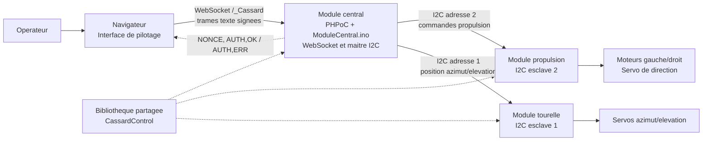
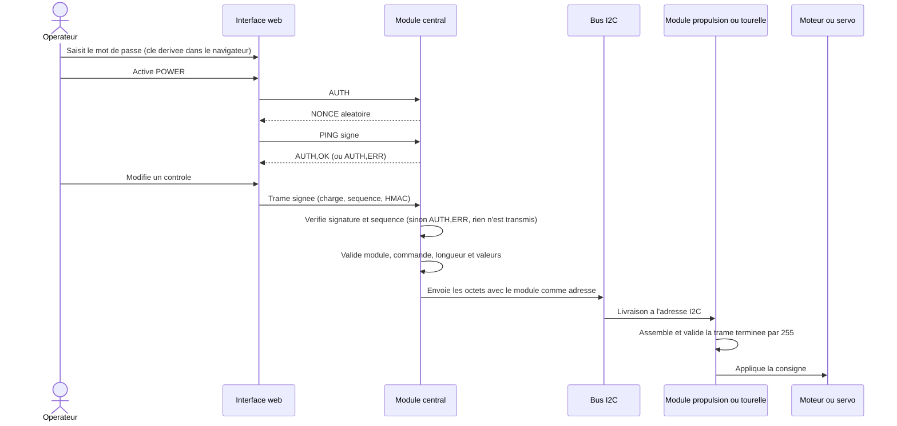

# Architecture du pilotage

## Vue des composants

Le navigateur ne commande pas directement les esclaves : il envoie des trames
texte signees au serveur WebSocket PHPoC du module central. Le central verifie
la signature et la sequence de chaque trame, valide les champs, convertit les
valeurs en octets, puis choisit l'adresse I2C d'apres le numero du module. Les
deux cartes esclaves n'ont pas de liaison reseau directe. Le mecanisme
d'authentification est decrit dans [securite.md](./securite.md).

## Flux d'une commande

## Responsabilites

- **Interface web** (`ModuleCentral/web`) : expose les controles de propulsion et
  de tourelle, derive la cle de pilotage et emet les commandes signees via le
  WebSocket PHPoC (`_cassard-link.js`).
- **Module central** (`ModuleCentral/ModuleCentral.ino`, `CassardAuth.h`) :
  maitre I2C; authentifie la session, verifie chaque trame, la valide puis la
  route vers l'adresse `1` ou `2`. A chaque nouvelle session, il arrete le
  moteur et recentre la barre.
- **Module propulsion** (`ModulePropulsion`) : esclave `2`; commande les moteurs
  continus et le servo de direction.
- **Module tourelle** (`ModuleTourelle`) : esclave `1`; commande les servos
  d'azimut et d'elevation.
- **CassardControl** (`libraries/CassardControl`) : code partage des commandes,
  du protocole et des controles bas niveau.

Le detail des codes, parametres et longueurs de trame est dans
[protocole.md](./protocole.md). Les raccordements et les etapes de mise en
service sont dans [montage-et-deploiement.md](./montage-et-deploiement.md).

## Sens des communications

Les commandes vont de l'interface vers le central puis vers l'esclave concerne.
Le central ne repond au navigateur que pour l'authentification (`NONCE`,
`AUTH,OK`, `AUTH,ERR`). Le protocole I2C n'envoie pas d'accuse de reception
applicatif aux pages web; celles-ci ne connaissent donc pas l'etat reel d'un
actionneur.
