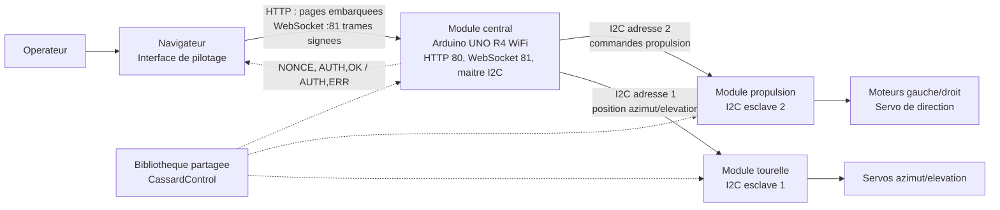
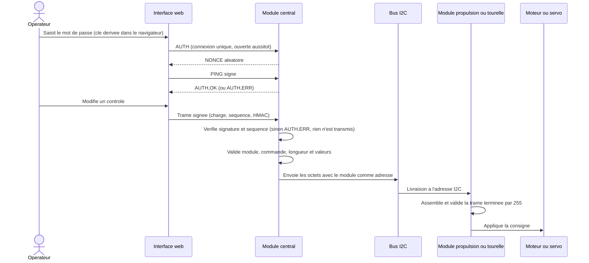

# Architecture du pilotage

## Vue des composants

Le navigateur ne commande pas directement les esclaves : il envoie des trames
texte signees au WebSocket du module central (port 81), qui sert aussi les
pages de l'interface depuis sa memoire flash (port 80). Le central verifie
la signature et la sequence de chaque trame, valide les champs, convertit les
valeurs en octets, puis choisit l'adresse I2C d'apres le numero du module. Les
deux cartes esclaves n'ont pas de liaison reseau directe. Le mecanisme
d'authentification est decrit dans [securite.md](./securite.md).

## Flux d'une commande

## Responsabilites

- **Interface web** (`web/`) : expose les controles de propulsion et
  de tourelle, derive la cle de pilotage et emet les commandes signees via le
  WebSocket du central (`_cassard-link.js`).
- **Module central** (`firmware/ModuleCentral/ModuleCentral.ino`, `CassardAuth.h`) :
  Arduino UNO R4 WiFi, point d'acces WPA2 (ou client d'une box); sert
  l'interface, authentifie la session du poste de pilotage, verifie chaque trame,
  la valide puis la route vers l'adresse `1` ou `2` en maitre I2C. Il arrete le
  moteur et recentre la barre a chaque nouvelle session et des que la liaison
  du pilote est perdue (WebSocket ferme ou sans reponse au ping, environ 3 s).
  La matrice de LED de la carte affiche clients, trames et erreurs (voir
  [montage-et-deploiement.md](./montage-et-deploiement.md#matrice-de-led-du-module-central)).
- **Module propulsion** (`firmware/ModulePropulsion`) : esclave `2`; commande les moteurs
  continus et le servo de direction.
- **Module tourelle** (`firmware/ModuleTourelle`) : esclave `1`; commande les servos
  d'azimut et d'elevation.
- **CassardControl** (`firmware/libraries/CassardControl`) : code partage des commandes,
  du protocole et des controles bas niveau.

Le detail des codes, parametres et longueurs de trame est dans
[protocole.md](./protocole.md). Les raccordements et les etapes de mise en
service sont dans [montage-et-deploiement.md](./montage-et-deploiement.md).

## Sens des communications

Les commandes vont de l'interface vers le central puis vers l'esclave concerne.
Le central ne repond au navigateur que pour l'authentification (`NONCE`,
`AUTH,OK`, `AUTH,ERR`, `AUTH,REPRISE`). Le protocole I2C n'envoie pas d'accuse de reception
applicatif aux pages web; celles-ci ne connaissent donc pas l'etat reel d'un
actionneur.
